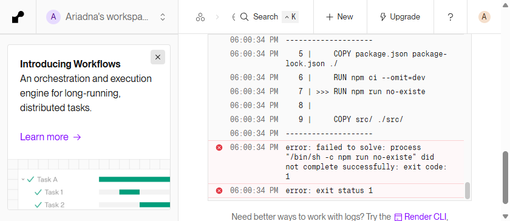
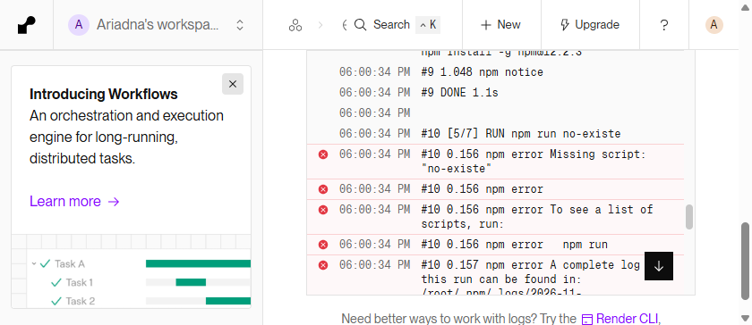
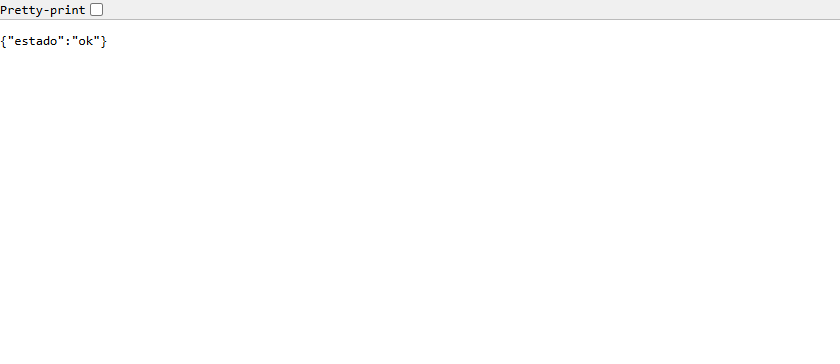

# Bitácora del Día 9 · Contenedor Docker y despliegue en Render

## Objetivo

Empaquetar `mini-inventario` en una imagen de producción y comprobar el ciclo de despliegue en Render: funcionamiento, fallo de compilación deliberado, diagnóstico y recuperación. El servicio objetivo es el de [`jimesssss/mini-inventario`](https://github.com/jimesssss/mini-inventario), no el ERP que está abierto en el workspace principal.

## Servicio y configuración observada

- Servicio: `mini-inventario` (`srv-dc45ucflk1mc739nlua0`), conectado a la rama `main` del repositorio correcto.
- URL pública: [https://mini-inventario-hbr5.onrender.com](https://mini-inventario-hbr5.onrender.com).
- Configuración observada por MCP: `autoDeploy=yes`, repositorio `jimesssss/mini-inventario`, rama `main`.
- El MCP oficial de Render se usó solo para lectura de servicios, despliegues y logs. La escritura de variables desde la API fue rechazada con HTTP 403; la configuración se completó después desde el dashboard de Render.
- Variables de entorno configuradas en Render: `SUPABASE_URL` y `SUPABASE_PUBLISHABLE_KEY`. Se corrigió `SUPABASE_URL` para apuntar al proyecto Supabase (`hxsseqjndqjfueapmeif`) y se configuró la clave publishable vigente. No se guardó ni se incluyó su valor en Git.
- Despliegue posterior a la configuración: `dep-dc4dp3bl550s739010i0`, estado `live`.
- Comprobaciones finales: `GET /api/salud` devolvió HTTP 200; `GET /api/configuracion` devolvió HTTP 200 y se validaron en memoria el proyecto objetivo y el prefijo publishable, sin imprimir la clave. La API de salud de Supabase respondió HTTP 200.
- La consulta REST de `productos` sin sesión devolvió HTTP 401 y `/api/productos` sin sesión devolvió HTTP 401. No se creó una cuenta de prueba ni se modificaron datos; la consulta protegida requiere una sesión autenticada y respeta RLS.
- Evidencia GitHub: el [PR #23](https://github.com/jimesssss/mini-inventario/pull/23) está fusionado en `main` y su verificación Playwright terminó correctamente. La suite local actual también pasa (9/9).
- El servicio usa Docker y su configuración apunta al `Dockerfile` en la raíz.
- Los cambios de configuración y el redeploy se realizaron desde el dashboard autenticado, no desde el MCP.

## Dockerfile, línea por línea

| Línea | Instrucción | Propósito |
| --- | --- | --- |
| 1 | `FROM node:22-alpine` | Usa Node.js 22 sobre Alpine como imagen base ligera. |
| 3 | `WORKDIR /app` | Define el directorio de trabajo dentro del contenedor. |
| 5 | `COPY package.json package-lock.json ./` | Copia primero los manifiestos para aprovechar la caché de dependencias. |
| 6 | `RUN npm ci --omit=dev` | Instala dependencias reproducibles y omite las de desarrollo. |
| 8 | `COPY src/ ./src/` | Incluye el código del servidor. |
| 9 | `COPY public/ ./public/` | Incluye los recursos estáticos de la aplicación. |
| 11 | `ENV NODE_ENV=production` | Activa el entorno de producción de Node. |
| 12 | `ENV PORT=3000` | Define el puerto predeterminado; Render puede proporcionar `PORT`. |
| 14 | `EXPOSE 3000` | Documenta el puerto esperado por el contenedor. |
| 16 | `USER node` | Ejecuta el proceso sin privilegios de root. |
| 18 | `CMD ["node", "src/server.js"]` | Inicia el servidor Express. |

`src/server.js` escucha en `0.0.0.0` y usa `process.env.PORT || 3000`, por lo que recibe tráfico de fuera del contenedor y respeta el puerto asignado por la plataforma.

## Exclusión de secretos y archivos locales

El archivo `.dockerignore` excluye `.env`, `.env.*`, `node_modules`, `.git`, `tests`, `entregas` y artefactos locales. Así, los archivos de entorno no forman parte del contexto enviado al constructor. El `Dockerfile` copia explícitamente solo manifiestos, `src/` y `public/`; no copia `.env`. No se incluyeron valores secretos en el repositorio ni en esta bitácora.

## Prueba local con Docker

- Imagen construida desde la raíz del proyecto: `docker build -t mini-inventario .`
- Contenedor temporal ejecutado con un `.env` local que contenía únicamente `SUPABASE_URL` y `PORT`; el archivo estaba ignorado por Git y se eliminó al terminar.
- Se consultó `http://localhost:3000/api/salud`: HTTP 200 y `{"estado":"ok"}`.
- El contenedor temporal `test-inv` se eliminó después de la prueba.
- La suite del proyecto pasó: 9 pruebas aprobadas, 0 fallidas.

## Diagnóstico inicial de Render

La consulta de solo lectura al despliegue enlazado y la vista de logs del dashboard mostraron `build_failed`. El despliegue `dep-dc45ucnlk1mc739nlvgg` fue el **primer despliegue** del servicio y revisó el commit `8d21845b5843b0e8756aff966f5626b8b06b49a2` en `main`, anterior al merge del Dockerfile. Los logs de Render muestran:

```text
==> Checking out commit 8d21845b5843b0e8756aff966f5626b8b06b49a2 in branch main
#1 [internal] load build definition from Dockerfile
#1 transferring dockerfile: 2B done
error: failed to solve: failed to read dockerfile: open Dockerfile: no such file or directory
error: exit status 1
```

**Causa exacta del fallo de Render:** el commit que Render compiló no incluía un `Dockerfile` en la ruta configurada (`./Dockerfile`). La fase de carga del build context recibió un Dockerfile de 2 bytes y BuildKit no pudo abrirlo. No hay una línea de Dockerfile que señalar: el archivo no existía en el commit desplegado. Render marcó el build como fallido con código de salida 1.

Después se publicó el commit de documentación (`4e8de269`) y el commit con el fallo intencional (`ab342588`). Aunque la configuración estaba en rama `main` y `autoDeploy=yes`, no se inició un build automático para esos commits. Tras esperar más de 60 segundos y revisar el historial, se seleccionó `ab342588` desde **Manual Deploy → Deploy a specific commit** en el dashboard autenticado de Render para poder ejecutar el diagnóstico solicitado. Render creó el despliegue `dep-dc4cg2m1egvs738076j0`, que terminó en `build_failed`. El historial registra además el evento `auto_deploy_disabled` generado por el despliegue manual; tras desplegar la versión corregida, se reactivó `On Commit` y se verificó de nuevo `autoDeploy=yes`.

## Fallo controlado `RUN npm run no-existe`

El cambio temporal se publicó en `main` como `ab342588`, insertando `RUN npm run no-existe` en la línea 7. La construcción local reprodujo el error exacto:

```text
npm error Missing script: "no-existe"
Dockerfile:7
ERROR: process "/bin/sh -c npm run no-existe" did not complete successfully: exit code: 1
```

**Diagnóstico del punto 9:** los logs del despliegue real de Render `dep-dc4cg2m1egvs738076j0` (commit `ab342588ec72b5525c3cbc65789746eb9a63232f`) muestran que BuildKit ejecutó el paso `[5/7] RUN npm run no-existe` y terminó con:

```text
#10 [5/7] RUN npm run no-existe
#10 0.156 npm error Missing script: "no-existe"
#10 ERROR: process "/bin/sh -c npm run no-existe" did not complete successfully: exit code: 1
error: failed to solve: process "/bin/sh -c npm run no-existe" did not complete successfully: exit code: 1
```

Render identifica la línea exacta:

```text
Dockerfile:7
7 | >>> RUN npm run no-existe
```

La causa es que `package.json` no define un script llamado `no-existe`; `npm run` sale con código 1 y BuildKit aborta la construcción. El despliegue controlado terminó en `build_failed` tras 24.7 segundos. La instrucción se retiró en `d19255a`. Después se desplegó la revisión corregida actual (`5d0e866`) y Render la marcó `live`. Se verificó `GET https://mini-inventario-hbr5.onrender.com/api/salud`: HTTP 200, `{"estado":"ok"}`. La configuración quedó con auto-deploy `On Commit` (`autoDeploy=yes`).

## Capturas de evidencia

Las capturas se tomaron del dashboard autenticado de Render y de la respuesta pública después del despliegue reparado:

1. Build de Render que muestra la instrucción `RUN npm run no-existe` y el fallo de BuildKit:

   

2. Log de Render con `npm error Missing script: "no-existe"` y la referencia a `Dockerfile:7`:

   

3. Respuesta pública del endpoint de salud tras la reparación; el estado HTTP 200 se verificó por separado con la petición:

   

## Bitácora de actividades

| Fecha | Actividad | Resultado / evidencia |
| --- | --- | --- |
| 26 nov 2026 | Revisión de Docker y de la aplicación | Dockerfile de producción, `.dockerignore`, listener `0.0.0.0` y puerto configurable integrados en [PR #23](https://github.com/jimesssss/mini-inventario/pull/23). |
| 26 nov 2026 | Pruebas locales | Imagen construida; contenedor temporal respondió 200 en `/api/salud`; suite del proyecto: 9/9. |
| 26 nov 2026 | Consulta inicial a Render | MCP oficial consultado en el workspace confirmado; se identificó el servicio, la URL y un despliegue fallido por ausencia del Dockerfile en el commit previo. |
| 26 nov 2026 | Push inicial de evidencia | `4e8de269` se publicó en `main`; no apareció un despliegue nuevo en Render. |
| 26 nov 2026 | Diagnóstico de despliegue (punto 9) | En el dashboard y en el historial de solo lectura se consultaron `dep-dc45ucnlk1mc739nlvgg` y sus logs: primer despliegue de `8d21845`, build fallido porque no existía `./Dockerfile`; BuildKit terminó con `exit status 1`. No hay número de línea porque el archivo no estaba presente en ese commit. |
| 26 nov 2026 | Prueba controlada y espera de auto-deploy | `ab342588` se publicó con `RUN npm run no-existe`; al esperar más de 60 segundos no apareció un despliegue automático, aunque el servicio estaba enlazado a `main`. |
| 27 nov 2026 | Despliegue fallido y diagnóstico (punto 9) | Desde el dashboard se desplegó específicamente `ab342588`. Render registró `dep-dc4cg2m1egvs738076j0` como `build_failed`: `npm error Missing script: "no-existe"`, `Dockerfile:7`, salida 1. El dashboard muestra el paso `[5/7] RUN npm run no-existe`. |
| 27 nov 2026 | Reparación y comprobación pública | Se desplegó `5d0e866` (Dockerfile corregido); Render lo marcó `live`. `/api/salud` respondió HTTP 200 con `{"estado":"ok"}` y `autoDeploy=yes` quedó restaurado. |
| 27 nov 2026 | Conexión de Render con Supabase | Se detectó que Render tenía una URL del dashboard de Supabase en lugar de la URL del proyecto y una variable de clave con nombre distinto al que espera la app. Se corrigieron `SUPABASE_URL` y `SUPABASE_PUBLISHABLE_KEY` desde el dashboard; el redeploy `dep-dc4dp3bl550s739010i0` quedó `live`. `/api/configuracion` y `/auth/v1/health` devolvieron 200. |
| 27 nov 2026 | Verificación de acceso protegido | Las peticiones sin sesión a REST `productos` y `/api/productos` respondieron 401; no se consultaron ni alteraron filas de usuario. Para probar CRUD se requiere una sesión válida. |
| 27 nov 2026 | Verificación GitHub y pruebas | El PR #23 está fusionado en `main`; su comprobación Playwright terminó `success`. La suite local volvió a pasar: 9/9. |

### Prompts y decisiones

- **Prompt clave:** completar el Día 9 con Docker, servicio Render, despliegue fallido controlado, diagnóstico por logs y reparación.
- **Decisión/error de la IA:** la primera consulta de servicios omitió `workspaceId` y MCP la rechazó; se pidió confirmación del workspace antes de reintentar. Además, el primer `docker build` se lanzó desde la raíz del workspace padre y falló porque allí no hay `Dockerfile`; se detectó por `open Dockerfile: no such file or directory` y se corrigió usando `mini-inventario-target` como contexto.
- **Comando aprobado:** `docker build -t mini-inventario .` y el contenedor local temporal se validaron con `/api/salud` y se eliminaron al terminar. Para satisfacer el punto 9, se aprobó desplegar manualmente `ab342588`; Render advirtió que eso desactiva el auto-deploy. Tras guardar los logs, se desplegó la revisión corregida y se reactivó `On Commit`.
- **Prompt clave adicional:** completar también la integración de Supabase, Render y GitHub, sin versionar credenciales.
- **Decisión/error adicional de la IA:** inicialmente se atribuyó el HTTP 503 a una variable ausente. La respuesta 503 se volvió a probar después del redeploy; la inspección de Render mostró que `SUPABASE_URL` era una URL del dashboard y que la clave estaba bajo `SUPABASE_KEY`. Se corrigieron ambos nombres/valores y se volvió a desplegar.
- **Comando rechazado:** la escritura vía API de Render no se forzó tras recibir HTTP 403; se evitó usar una operación de reemplazo total de variables que pudiera borrar configuración existente. La modificación se hizo de forma acotada en el dashboard.
- **Verificación del resultado:** el dashboard confirma el despliegue `dep-dc4dp3bl550s739010i0` en `live`; Render `/api/salud` y `/api/configuracion` respondieron HTTP 200. La API de Auth de Supabase respondió HTTP 200 al usar la clave publishable recibida en memoria desde la configuración de Render; la clave no se imprimió ni se versionó. Las solicitudes sin sesión a productos reciben HTTP 401, como exige la autenticación; no se creó usuario ni se modificaron filas, por lo que un CRUD con sesión real queda fuera de esta evidencia. El PR #23 y su check Playwright están completados y las 9 pruebas locales pasan.
