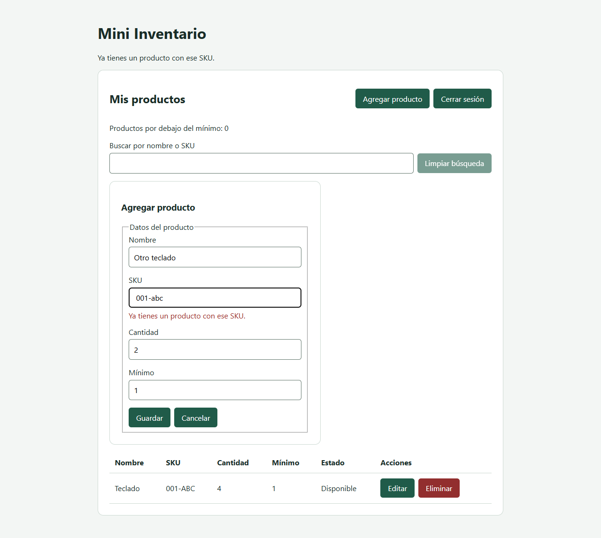
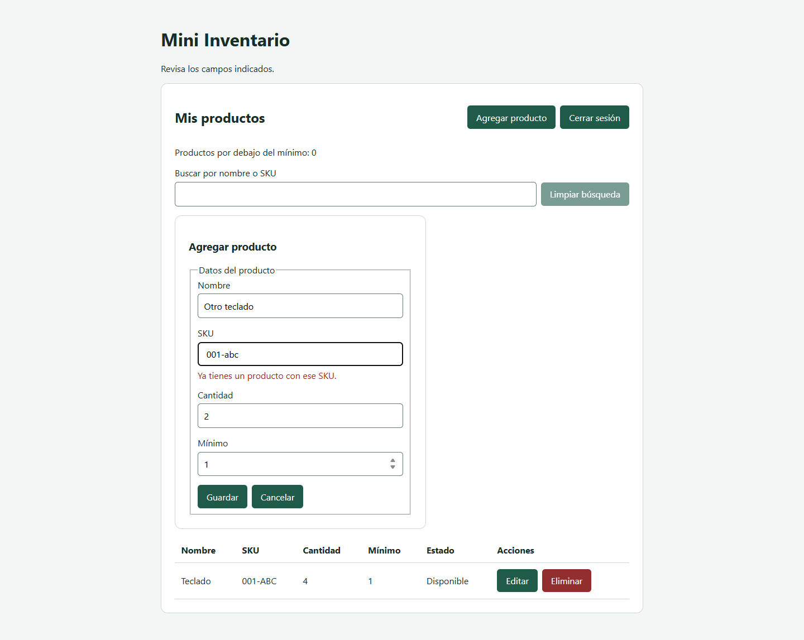
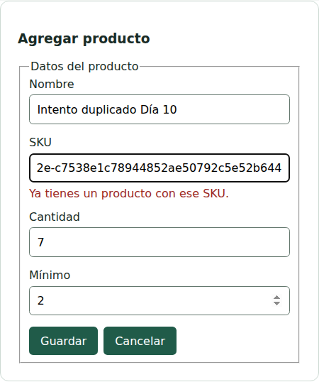

# Día 10 · Incidente de SKU duplicado

## Enlaces y estado

- Issue: [#24 — Validar SKU duplicado antes de enviar el formulario](https://github.com/jimesssss/mini-inventario/issues/24)
- Pull Request: [#25 — validar SKU duplicado antes de enviar](https://github.com/jimesssss/mini-inventario/pull/25).
- Aplicación: [https://mini-inventario-hbr5.onrender.com](https://mini-inventario-hbr5.onrender.com)

## Incidente y causa

Se evaluó primero el reporte A (cantidad negativa). El HTML limita cantidad y mínimo a enteros no negativos, el navegador valida esos límites y la API rechaza valores menores que cero. La migración existente también declara `CHECK (cantidad >= 0)`.

Se evaluó después el reporte B (SKU duplicado en la misma cuenta). La API maneja el error PostgreSQL `23505` como HTTP 409 y la migración existente define unicidad por propietario mediante `unique (user_id, lower(sku))`. Por tanto, el código impide persistir el duplicado; el defecto reproducible era de UX: el formulario no comprobaba la lista antes de enviar el POST/PATCH y esperaba la respuesta del servidor.

La corrección valida el SKU sin distinguir mayúsculas/minúsculas contra los productos cargados del usuario, marca el campo con un mensaje accesible y no envía la solicitud. Al editar, se excluye el producto actual. La API y la restricción de Supabase siguen siendo las defensas finales.

## Evidencia

- La prueba de interfaz añadida falla antes de la corrección: esperaba que no se enviara el POST, pero observó que el contador de solicitudes aumentó (`2 !== 1`). Salida completa: [prueba-antes-de-corregir.txt](./prueba-antes-de-corregir.txt).
- Captura del flujo antes de la corrección, reproducido localmente con el JavaScript de `main` y Auth/API simuladas: . La ejecución está en [reproduccion-local.txt](./reproduccion-local.txt).
- La prueba Playwright local, con Auth/API simuladas, pasa y confirma que no sale ningún POST duplicado: [playwright-verde.txt](./playwright-verde.txt).
- Captura local de la validación corregida: .
- `npm test`: 9/9 pruebas aprobadas; incluye validación de servidor para cantidad inválida y manejo del error `23505`.
- Se ejecutó Playwright contra la página pública de Render: la página y el JavaScript son los desplegados, el mensaje aparece y se confirma que no se envía ningún POST. Para aislar la prueba, Auth y `/api/productos` se simularon; por eso esta evidencia verifica la interfaz desplegada, no una sesión/backend real. Resultado: [render-ui-mock.txt](./render-ui-mock.txt); captura: .
- **Verificación autenticada en producción:** el [PR #26](https://github.com/jimesssss/mini-inventario/pull/26) añadió un smoke test opt-in que usa los secretos de prueba existentes en GitHub Actions, sin exponerlos. El [run #18](https://github.com/jimesssss/mini-inventario/actions/runs/45953128990) pasó 5 pruebas de flujo autenticado contra Supabase, 1 prueba de interfaz simulada y 1 contra Render: inició sesión en Supabase, creó un producto sintético, confirmó que el SKU duplicado (con distinta capitalización) muestra el error y no genera un segundo POST, y verificó la eliminación del producto temporal. Captura recortada del formulario real: .

**Verificación de Supabase:** una consulta `SELECT` de solo lectura encontró 1 fila en `public.productos`, 0 cantidades negativas y 0 grupos con SKU repetido por usuario (comparación con `lower(sku)`). La consulta de esquema confirmó la restricción `productos_cantidad_no_negativa` (`CHECK (cantidad >= 0)`) y el índice único `productos_user_id_sku_unico`. No había filas existentes que corregir ni se modificó el esquema. La prueba de producción creó después un registro sintético y confirmó su eliminación y ausencia residual.

**Límite de evidencia de producción:** la prueba autenticada confirma el comportamiento actual del servicio, no demuestra que un usuario haya sufrido un incidente histórico. Se revisó Render en el rango disponible de 7 días: los logs muestran arranques y despliegues, no solicitudes de productos; la opción **Request logs** aparece deshabilitada para este servicio. Por eso no hay un log histórico que atribuir a un cliente. El smoke test usó un registro sintético y confirmó su limpieza; la captura autenticada muestra solo el formulario, sin listar otros productos.

## Cierre del ciclo

- **Aprendizaje:** la restricción de servidor/base de datos protege la integridad, pero la interfaz debe detectar errores previsibles antes de enviar la solicitud.
- **Siguiente requisito:** conservar la cuenta de CI dedicada y volver a ejecutar el smoke test opt-in si cambia el flujo de autenticación, el formulario o el despliegue de Render.
- **Delegaría:** una revisión independiente de accesibilidad y de la unicidad por propietario frente a los requisitos comerciales.
- **Seguiría revisando:** despliegue de Render, ejecución de las pruebas E2E con las credenciales de CI y que las respuestas 409 continúen cubriendo carreras entre solicitudes.

## Bitácora obligatoria

- **Prompt clave:** completar el Día 10 evaluando los reportes de cantidad negativa y SKU duplicado, y corregir el caso aplicable con evidencia.
- **Decisión y causa encontrada:** la cantidad negativa ya estaba rechazada en formulario/API/SQL; para SKU la persistencia también estaba protegida. Se enfocó el cambio en impedir el envío innecesario desde la interfaz, sin afirmar que hubiera corrupción de datos.
- **Error de prueba detectado:** el primer Playwright usó `getByLabel('SKU')`, que coincidía tanto con el buscador como con el campo del formulario. Playwright reportó strict mode; se corrigió limitando el selector al formulario. La reproducción y las capturas antes/después usan una API simulada, no modifican datos.
- **Comando aprobado:** `npm test` (9/9), Playwright local y `npx playwright test --config=playwright.production.config.js` en el CI del PR #26 (1/1 producción). La prueba de producción usa los secretos de Actions; no se copiaron ni imprimieron credenciales. La primera ejecución TDD de `npm test` falló antes de la corrección como se esperaba.
- **Limpieza y privacidad:** la prueba creó un producto con SKU aleatorio y lo eliminó con el mismo token del propietario; el helper verificó que ya no quedara ninguna fila coincidente. La captura se limita al formulario y no incluye el inventario.
- **Logs:** en Render se revisó el rango de 7 días; solo aparecen mensajes de arranque/despliegue y **Request logs** está deshabilitado. No se inventó ni se atribuyó un evento histórico.
- **Comprobación:** el test autenticado confirma el rechazo del duplicado antes del POST contra la app/API de Render y Supabase reales; Render salud respondió HTTP 200. Las consultas `SELECT` previas confirmaron las restricciones y no se ejecutó SQL destructivo.
